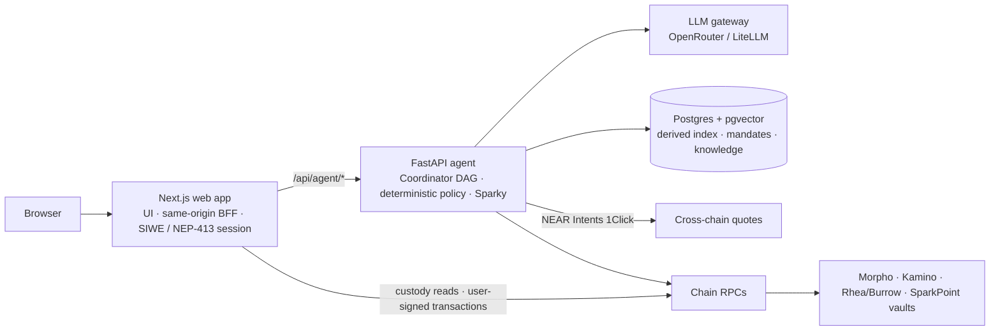

# SparkPoint Pivot

**Live demo:** [https://beta.sparkpoint.io](https://beta.sparkpoint.io)

SparkPoint Pivot is a **non-custodial, AI-native DeFi assistant**. It pairs manual onchain
pages with **Sparky**, a chat assistant that can perform the same operations: quote and
confirm swaps, discover and enter yield vaults, and review a multi-chain portfolio.

The assistant proposes; the user always signs. SparkPoint never holds keys, and custody-critical
reads and withdrawals stay available even when the AI service is offline.

## What it does

- **Sparky AI chat** (`/chat`) — ask for a swap, a vault, or a portfolio review and get
  structured, signable actions in the same conversation.
- **Manual pages** — `/swap`, `/vault`, and `/portfolio` expose the same capabilities without chat.
- **Cross-chain swaps** — NEAR Intents (1Click) quotes and deposits across EVM, Solana, and NEAR.
- **Onchain yield** — Morpho curated vaults on Base EVM, Kamino on Solana, and Rhea/Burrow on NEAR,
  alongside SparkPoint's curated vault registry.
- **Multi-chain wallets** — EVM (Base, Base Sepolia, Robinhood testnet), Solana, and NEAR, with
  SIWE and NEP-413 login flows.

## Architecture



- **`apps/web`** — Next.js App Router UI, wallet/session handling, and the server-side BFF that
  keeps the agent URL and service token out of the browser.
- **`services/agent`** — FastAPI service with the coordinator, policy gate, Sparky persona,
  knowledge retrieval, earn/cross-chain rails, and the data layer.
- **`contracts`** — Foundry contracts for the SparkPoint vault and ERC-4337 account/session stack.
- **`packages/shared`** — Shared chain metadata, addresses, ABIs, policy constants, and wire schemas.
- **`specs/`, `docs/`** — Spec-driven design history, architecture notes, and runbooks.

The core safety property is structural: the browser talks to chains directly for custody reads and
the user's wallet signs every state-changing transaction. Postgres and the agent are accelerators,
never the withdrawal path.

## Quickstart

Prerequisites: Node.js 22, `pnpm` 9.15.9, Python 3.12 with `uv`, Foundry, and optionally Docker and
Postgres 16 + pgvector. See [DEVELOPMENT.md](./DEVELOPMENT.md) and
[specs/001-sparkpoint-pivot-mvp/quickstart.md](./specs/001-sparkpoint-pivot-mvp/quickstart.md)
for the full environment matrix.

```bash
git clone https://github.com/ObraHaus/sparkpoint-pivot.git
cd sparkpoint-pivot
pnpm install
cp .env.example .env.local   # fill in RPC / wallet / database values
pnpm dev                     # web app
```

Run the agent separately:

```bash
cd services/agent
uv sync
uv run uvicorn sparkpoint_agent.api.main:app --reload --port 8000
```

Build and test the contracts:

```bash
cd contracts
forge build
forge test
```

## Tests

```bash
# JavaScript / TypeScript workspace
pnpm lint
pnpm typecheck
pnpm test

# Python agent
cd services/agent
uv run ruff check .
uv run mypy src/sparkpoint_agent
uv run pytest -q
```

The test suites cover the web unit tests, the agent's policy/custody boundaries, and the Foundry
contract tests. CI runs the same gates in `.github/workflows/`.

## Repository layout

```text
sparkpoint-pivot/
├── apps/web/          # Next.js app, BFF, wallet auth, Sparky UI
├── services/agent/    # FastAPI agent, policy, earn/cross-chain rails, migrations
├── contracts/         # Foundry contracts and deployment scripts
├── packages/shared/   # Chain metadata, addresses, ABIs, schemas
├── specs/             # Spec-driven feature history
└── docs/              # Architecture, design handover, ops notes
```

## Security model

- User wallets are the only source of signing authority.
- The agent emits unsigned, simulated, policy-checked intents.
- Withdrawals and trust/exit surfaces are never gated on the AI service being healthy.
- Secrets live in environment variables; only `.env.example` is committed.

## License

MIT — see [LICENSE](./LICENSE).
