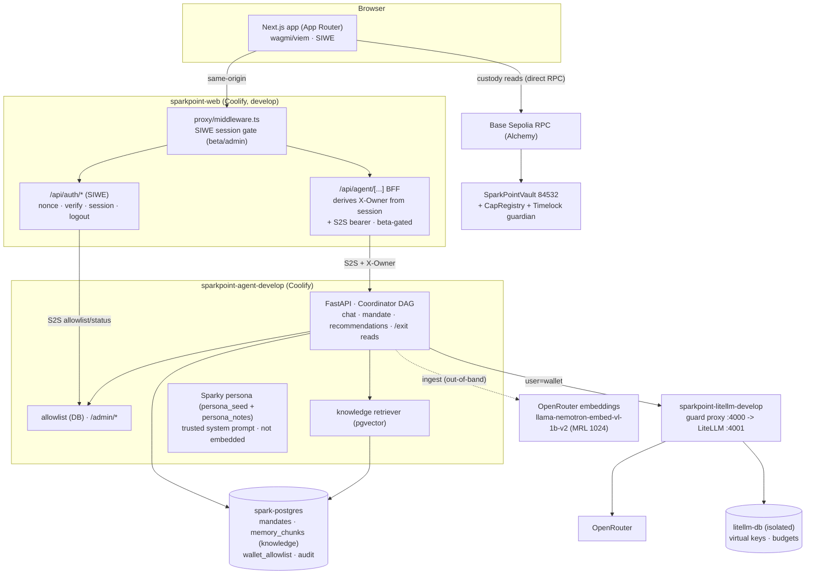

# SparkPoint Pivot — architecture as-built (develop)

Living snapshot of the **deployed develop** stack as of 2026-07-16 (Phases A/B/B.1/C). Ground truth
for how the system is actually wired — pairs with `COOLIFY.md` (infra inventory), `GATES.md`
(decision ledger), and `docs/ops/known-limitations.md` (honest caveats). **Production is separate**
(client infra, TBD); this describes dev/staging on OH Coolify only.

## Topology

## Request / auth flows

**SIWE login** (`/connect` → `/verify`): wallet signs an EIP-4361 message (nonce from
`/api/auth/nonce`, `expirationTime` required). `/api/auth/verify` binds the **domain** (`SIWE_DOMAIN`
env, not the message body) + pins **chainId** (`SIWE_CHAIN_ID`), verifies via viem `verifySiweMessage`
(recompute-HMAC path — see below), resolves `{beta, admin}` from the agent allowlist, and mints an
**HMAC-signed httpOnly session cookie**. The nonce is cleared on every outcome.

**Session verification** uses Web Crypto **HMAC-SHA256** and runs in BOTH the edge middleware and the
Node routes. It verifies by **recomputing** the HMAC via `crypto.subtle.sign({name:"HMAC"})` over a
`Uint8Array` + constant-time compare — NOT `crypto.subtle.verify`, which throws/misbehaves in the Next
edge runtime with the bare-string algo. `SESSION_SECRET` is referenced directly in the middleware so
Next inlines it into the edge bundle.

**Gates**: the root middleware gates page routes — (app) shell needs a `beta` session (else →
`/connect`, or the honest `/verify` not-in-beta state); `/admin` needs an `admin` session, else an
**invisible 404** (`/gate-404` rewrite). The **BFF** additionally gates `/api/agent/*`: identity is
derived from the session (the browser cannot assert an owner), and the assistant + write endpoints
require `beta` (403 otherwise); only `readyz`/`healthz` are exempt. **Never gated:** landing,
`/connect`, `/verify`, `/exit`, `/trust` (+subpaths) — the non-custody escape hatches (N2).

**Custody reads** (vault balance, caps, `paused()`, Trust Center, `/exit`) go **direct to RPC** from
the browser, independent of the agent — so the app degrades safely when the agent is down (N2).

**Per-user LLM budgets**: the verified wallet is threaded as the LiteLLM `user` on planner /
recommender / literacy calls.

## Live resources (develop)

| Resource | Coolify UUID | FQDN / host | Notes |
|---|---|---|---|
| `sparkpoint-web` | `i4cw0ogsookkkocsw808gwc4` | `https://71zxh8ed1ejf8132l46joodp17.aldrickb.app` | full app; `SITE_LOCKED=false`; BFF + SIWE |
| `sparkpoint-agent-develop` | `fw8s4ko4080wgk8okso8go48` | `8jcvimzny63tw81xkfl3wwmdzz.aldrickb.app` (:8000) | hardened public FQDN behind the BFF S2S bearer |
| `sparkpoint-litellm-develop` | `fog4okko4csgscgos00ws48c` | `fi5zmq5osp0g3aam93gnv2j4rl.aldrickb.app` (:4000) | guard proxy 404s `/`,`/docs`,`/openapi.json`,`/ui/*`; alias `sparkpoint-chat` → OpenRouter |
| `sparkpoint-litellm-db-develop` | `t4w8wokwgk4ooosk0cwckg8g` | internal | isolated (keys/budgets) — NOT spark-postgres |
| `spark-postgres` | (existing) | private LAN | mandates + `memory_chunks` (knowledge) + `wallet_allowlist` + audit; migrations 0001–0007 |

On-chain (Base Sepolia 84532): vault `0x15D269B1D4fb3581E5a47482A70215e63Ed547f2`, guardian
(OZ TimelockController) `0x0A21A9B4c2cd2d6a68EC828188826B673572d720`.

## Key env

- **web**: `SESSION_SECRET` (secret; signs the session), `SIWE_DOMAIN` / `SIWE_CHAIN_ID` (bind SIWE),
  `AGENT_INTERNAL_URL` + `AGENT_S2S_TOKEN` (BFF → agent), `SITE_LOCKED=false`, `NEXT_PUBLIC_BASE_SEPOLIA_RPC_URL`.
- **agent**: `BETA_ALLOWLIST` / `ADMIN_ALLOWLIST` (seed the DB allowlist on boot — the ONLY consumer),
  `DATABASE_URL`, `LITELLM_BASE_URL` / `LITELLM_API_KEY` (virtual key) / `LITELLM_MODEL`,
  `EMBEDDING_OPENAI_*` (ingest only), `SIM_FORK_RPC_URL`, `BASE_SEPOLIA_RPC_URL`, `SPARKPOINT_VAULT_ADDRESS`.
- **gateway**: `OPENROUTER_API_KEY` (ONLY here), `LITELLM_MASTER_KEY`, `DATABASE_URL` (→ isolated db).

## Inert / illustrative (marked in-app, NOT live)

> The Phase-3 build gate for each not-yet-live surface below is tracked in
> [`docs/phase-3-deferred.md`](phase-3-deferred.md).

- **ERC-4337 account + PolicyModule (US6)** — the Path-A stack is **deployed on Base Sepolia + proven live** (a real session-key UserOp passed the Alchemy bundler's ERC-7562 tracer + executed on-chain; feature 022, `contracts/deployments/84532/session-stack.md`). **US6 is now SHIPPED end-to-end on testnet** (#105 grant/revoke API + `0025_session_keys` + `sessionKeyExpiry` notif; #106 the 019-spine session-key submission path; #107 the **web client-side session-signer** — encrypted on-device key, a mode-0x01/EIP-191 signer whose `userOpHash` is byte-verified against the deployed EntryPoint, the "Let Sparky do it" CTA gated on a live grant + on-device key, and fully client-buildable revoke). The `StatusTag mock` is retired. Gate C: hands-off = no signature, **not** no human — every move is still an explicit click; no autonomous path; mainnet remains behind the recorded audit.
- **Admin panels** overview/users/tvl/stake/revenue/config show **"Sample data"** badges (no analytics/TVL/revenue backend); live-honest: gateway, allowlist, killswitch, system, audit.
- **Portfolio** allocation/positions/risk + the position-detail page are **"Sample data"**; only net worth reads live (agent, with a "Preview data" badge when disconnected).
- **Offline chat** keyword-router is labeled **"Demo mode"**.
- Chat replies have **no Obsidian grounding** yet (citations are recommender-only).
- Sui network shows **"coming soon"** (EVM-only today).

## Sparky persona (trusted voice, not RAG)

The chat assistant's character is a **trusted system-prompt block** composed once from
`services/agent/persona_seed/*.md` (+ live admin overrides in the isolated `persona_notes` table)
and prepended to the **literacy** prose agent. It is the *opposite* of the knowledge corpus: the RAG
retriever feeds *untrusted* reference text into the user turn, while the persona is *trusted* content
that steers voice. It is **never embedded** into `memory_chunks`, **never retrieved by similarity**,
and **never on the policy/propose/build path** (a coordinator boundary test enforces this — voice
can never influence a signable action, N2). Operators edit it live at `/admin/knowledge` → **Persona**
tab (admin-gated, PII-fail-closed, audited); a save reloads the voice with no redeploy. No embedder
required.

## Migrations (spark-postgres, applied via yoyo)

`0001_foundation` · `0002_vault` · `0003_assistant` · `0004_embedding_dim` · `0005_allowlists` ·
`0006_knowledge_enum` (adds `knowledge` source_kind) · `0007_knowledge_backfill` (migrates the corpus
off the `literacy_tip` shim) · `0013_persona_notes` (Sparky persona overrides + audit; isolated from
the RAG corpus — no enum, no vector). See `MIGRATIONS.md`.
